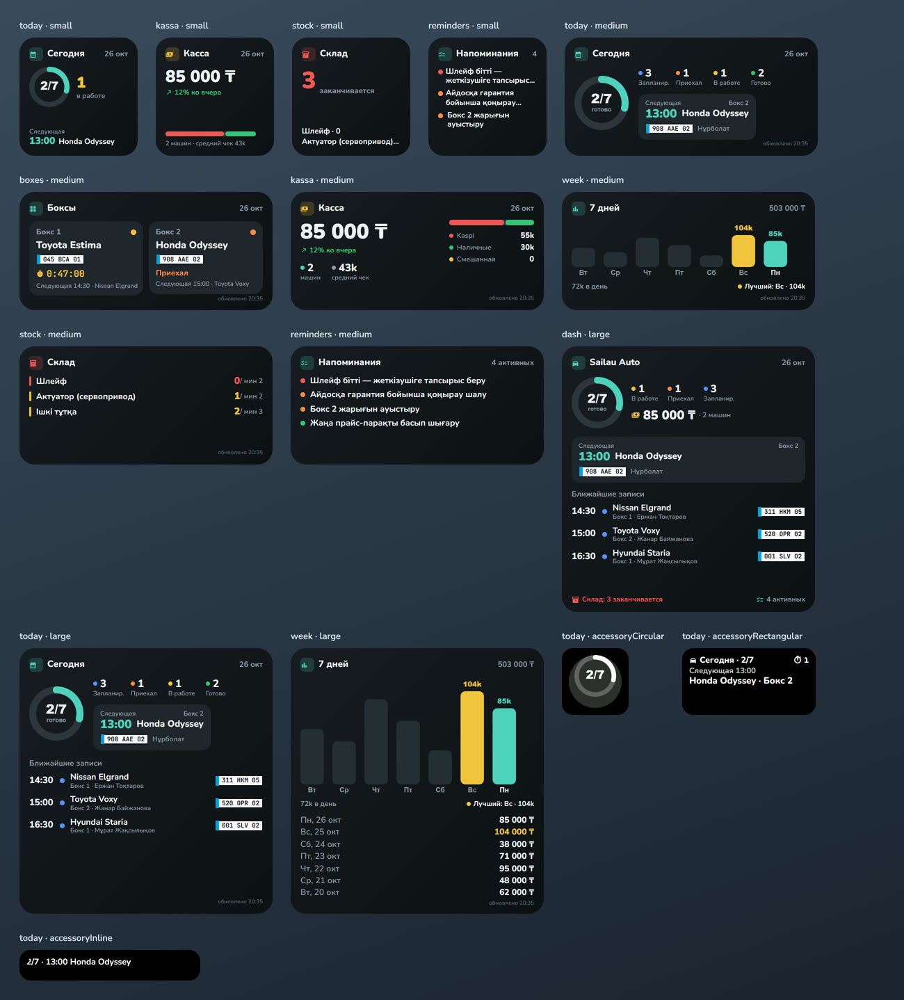

# Sailau Auto — виджеты для iPhone (Scriptable)

Виджеты на домашнем экране и экране блокировки, которые берут данные прямо из API Sailau Auto.
Нажатие на виджет открывает нужную страницу приложения. Mac не нужен, бэкенд менять не нужно.

## Варианты (параметр виджета)

| Параметр | Размеры | Что показывает | Кому |
|---|---|---|---|
| `today` | S · M · L | Кольцо «готово / всего», счётчики по статусам, следующая запись (время, машина, KZ-номер, бокс, мастер); L — ещё 5 ближайших | всем |
| `boxes` | S · M | Каждый бокс сейчас: машина в работе с **живым таймером** / «Приехал» / «Свободен» и что следующее | всем |
| `kassa` | S · M | Выручка за сегодня, Kaspi / наличные / смешанная, машин, средний чек, % ко вчера | всем (сравнение — владельцу и ст. мастеру) |
| `week` | S · M · L | Столбики выручки за 7 дней, итог, среднее, лучший день; L — список по дням | владелец, ст. мастер |
| `stock` | S · M · L | Что заканчивается на складе, остаток / минимум | всем |
| `reminders` | S · M · L | Активные напоминания по приоритету | всем |
| `dash` | L | Всё вместе: день, касса, следующая + 3 записи, склад, напоминания | всем |
| экран блокировки | круг · прямоуг. · строка | «3/8», следующая машина и время, сколько в работе | всем |

Добавьте слово `ru` для русских подписей (по умолчанию казахские), `demo` — показать пример без входа.
Примеры параметра: `today`, `boxes ru`, `kassa`, `week ru`, `dash`.

## Установка (5 минут)

1. Установить **Scriptable** из App Store (бесплатно).
2. В Scriptable нажать **+**, вставить содержимое файла `Sailau Install.js`, назвать скрипт `Sailau Install`, запустить ▶︎.
   Он скачает актуальный `Sailau Widget` (этот же скрипт обновляет виджет в будущем).
   _Без интернета/GitHub: можно просто создать скрипт `Sailau Widget` и вставить в него код `Sailau Widget.js`._
3. Открыть скрипт **Sailau Widget** → **Кіру / Войти** → телефон и пароль от Sailau Auto.
   Сохраняется только токен в Keychain iPhone, пароль не хранится. Токен продлевается сам.
4. Долгое нажатие на домашний экран → **+** → **Scriptable** → выбрать размер → **Добавить**.
5. Долгое нажатие на виджет → **Изменить виджет** → Script: **Sailau Widget**, When Interacting: **Open URL**, Parameter: например `boxes`.
6. Экран блокировки: долгое нажатие на экран блокировки → **Настроить** → виджеты → Scriptable → тот же скрипт.

## Как это работает

- Данные: `GET /api/bookings?date=…`, `/settings`, `/analytics/summary`, `/inventory`, `/reminders` — те же, что у приложения, с правами того, кто вошёл.
- iOS обновляет виджеты сама примерно раз в 5–15 минут; таймер в боксе тикает каждую секунду.
- Если сервер Render «спит» или нет сети, виджет показывает последние данные с пометкой «нет сети · кэш».
- Если токен устарел или пользователь деактивирован — виджет просит открыть скрипт и войти заново.

## Предпросмотр на ПК

`preview/` — эмулятор API Scriptable в браузере и рендер всех вариантов на демо-данных
(`node preview/render.mjs out.png [ru]`, нужны `playwright-core` и Chrome). Шрифты на ПК заменены похожими,
на iPhone будет системный SF Rounded.
